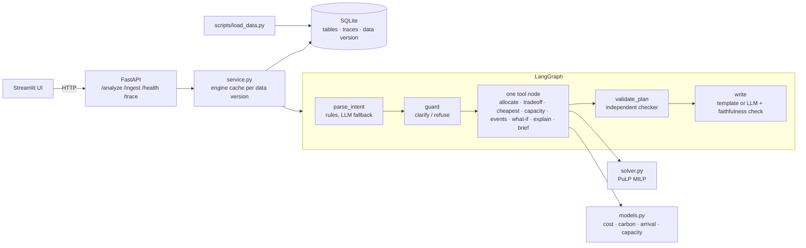

# Multi-Plant Order Allocation with Cost and Carbon

Allocates customer orders to three plants with a mixed-integer solver. It shows the
cost–carbon–delivery trade-off, re-plans when a plant loses capacity, explains its
choices and writes a management brief. **Every number comes from code (pandas + PuLP/CBC).
The LLM (Gemini) only interprets requests and words explanations, and a checker rejects
any number it writes that does not match a computed fact.**

| | |
|---|---|
| Stack | FastAPI + Pydantic v2 · LangGraph · PuLP (CBC) · pandas · SQLite · Streamlit + Plotly · Docker |
| LLM | `LLM_PROVIDER=gemini`, `LLM_MODEL=gemini-3.8-flash` (switchable; `MOCK_LLM=true` runs without one) |
| Results | 32/32 evaluation cases pass, 100% plan validity, 100% brief faithfulness ([eval/report.md](eval/report.md)) · 59 unit tests |

## Architecture



**Why this shape (architecture judgement).** Allocation, comparison and validation are
deterministic, so they are plain tool nodes, not agents. The LLM is used in two places
only:
1. **Parsing a request the rules don't recognise.** Common phrasings are parsed by rules
   with no LLM call; Gemini is the fallback. Either way the result is a Pydantic
   `Intent` that a deterministic **guard** checks: the plant exists, the order exists,
   the plant is eligible, the percentage is in range. An LLM that misreads, or is
   manipulated, can at worst ask a clarifying question; it can never break a rule.
2. **Wording.** Every answer first gets a deterministic template text. If the LLM writes
   a narrative instead, `writer.check_numbers` extracts every number from it and requires
   each to match a computed fact. It retries once, then falls back to the template.

We deliberately did **not** add a second agent: no step needs open-ended reasoning, and
each extra agent adds cost, latency and failure modes.

## The model

**Landed cost (R2)** = production (`unit_cost × qty`) + energy (`kWh/unit × price × qty`)
+ transport (`cost/unit × qty`) + duty (`duty_pct × (production + energy)`).
Duty is charged on the goods value leaving the plant; transport is not dutiable.

**Carbon (R3)** = `kWh/unit × plant carbon intensity that week × qty` + `transport kg/unit × qty`.

**Arrival (R5)** = production week start + 6 days (end of week) + transit days.

**Solver (R4).** A binary variable chooses one (order, plant, week) per order; another
variable marks an order unassigned.
- **Hard constraints:** shared weekly plant capacity (after capacity events) and eligibility.
- **Week choice:** an order is built in its `production_week` or deferred to a later week
  if capacity forces it, never built early.
- **Objective** (dimensionless, so weights mean the same thing on any data):

```
w_cost · cost/ref_cost + w_carbon · carbon/ref_carbon
  + w_late · (late_penalty · late_orders + 0.01 · days_late)
  + 10 · late_penalty · unassigned + tiny tie-breakers (deferral, moves)
```

- `ref_cost` and `ref_carbon` are the sums of each order's cheapest and greenest options.
- `late_penalty` = 1 + the largest weighted cost+carbon change any plan could make. So with
  `lateness = 1`, one extra late order always outweighs any cost or carbon saving:
  **delivery first, then cost vs carbon**. Delivery is a soft constraint so that
  impossible dates are *flagged*, not hidden (Annex A).
- CBC stops at 0.01% of the optimal objective or after 20 s. A plan that hits the time
  limit is reported as `FEASIBLE_TIME_LIMIT`, never as optimal.
- Dominated deferral options are pruned (701 candidates instead of 1,384), so every solve
  on the data pack is proven optimal in 0.3–3 s.

**Weights (R7): default 80% cost / 20% carbon.**
- This is the knee of the frontier on the data pack. It gets **91% of the achievable carbon
  cut** (3.16% of 3.47%) for **+0.33% cost**. The last 0.3 points of cut cost more than
  twice as much again.
- Each response states the **implied carbon price** of its weights,
  `(w_carbon / w_cost) × ref_cost / ref_carbon`: INR 15,354/t at the default. That turns an
  abstract weight into a number leadership can accept or change.
- `eval/run_eval.py` recomputes the table on any data, so the default can be re-checked.

| Carbon weight | Cost (INR) | Carbon (t) | Share of max cut | Extra cost | Implied INR/t |
|---|---|---|---|---|---|
| 0.0 | 9,140,289 | 279.8 | 0% | 0 | – |
| 0.1 | 9,156,711 | 272.4 | 76% | 16,423 | 6,824 |
| **0.2** | **9,170,449** | **270.9** | **91%** | **30,160** | **15,354** |
| 0.5 | 9,186,677 | 270.4 | 97% | 46,388 | 61,416 |
| 0.7 | 9,208,822 | 270.1 | 100% | 68,533 | 143,304 |

**Re-planning (R8).** A capacity event removes `capacity_loss_pct` of capacity, pro rata
by the days it overlaps each week. The re-plan is solved with a small penalty for moving
an order (plant or week) away from the base plan. On the data pack's events that moves
**up to 68% fewer orders** (E002: 8 vs 25) and solves **6–16× faster** than an unanchored re-solve, for a
similar cost (see [eval/report.md](eval/report.md)). The response lists every order that
moved, plus the change in cost, carbon and late orders.

## Run it

**Local (Python 3.12):**
```powershell
python -m venv .venv; .venv\Scripts\Activate.ps1
pip install -r requirements-dev.txt
copy .env.example .env        # add GEMINI_API_KEY, or set MOCK_LLM=true
python scripts/validate_data.py                      # validation report (show in demo)
uvicorn src.api:app --port 8000                      # API; seeds SQLite from data/ on first start
streamlit run ui/app.py                              # UI at http://localhost:8501
```

**Docker:** `docker compose up --build`. This starts the API on :8000 and the UI on
:8501. SQLite lives on the `appstate` volume. Ollama, if used, runs on the host
(`OLLAMA_BASE_URL`).

**Load judge data you have not seen** (Annex B CSVs; `capacity_events.csv` optional):
```powershell
python scripts/load_data.py --data-dir path\to\csvs          # validates, then loads
docker compose exec api python scripts/load_data.py --data-dir /app/judge_data   # put files in ./judge_data
```
or upload one table at a time with `POST /ingest`. The running API picks up new data on
the next request.

**Tests and evaluation:**
```powershell
pytest -q                          # 59 tests, no LLM or network needed
ruff check src tests scripts ui eval
python eval/run_eval.py            # writes eval/report.md; add --live-llm to use Gemini
```

## API (Section 6 contract)

```bash
# plan / question (weights optional; cost+carbon are normalised to sum to 1)
curl -s -X POST localhost:8000/analyze -H "Content-Type: application/json" \
  -d '{"request": "Allocate this week'"'"'s orders.", "weights": {"cost": 0.8, "carbon": 0.2}}'

curl -s -X POST localhost:8000/analyze -H "Content-Type: application/json" \
  -d '{"request": "What does a 10% carbon cut cost?"}'

# what-if as structured JSON (no text parsing involved)
curl -s -X POST localhost:8000/analyze -H "Content-Type: application/json" \
  -d '{"request": "re-plan", "scenario": {"capacity_changes": [{"plant": "B", "loss_pct": 0.3, "from_date": "2026-11-02", "to_date": "2026-11-15"}]}}'

# add data while running (table: orders | plants | transport_duties | capacity_events)
curl -s -X POST localhost:8000/ingest -F "file=@capacity_events.csv" \
  -F 'meta={"table": "capacity_events", "mode": "replace"}'

curl -s localhost:8000/health
curl -s localhost:8000/trace/al-62c1d8
curl -s localhost:8000/validation        # extra: validation report for the loaded data
```

`scenario` keys: `capacity_changes`, `event_ids` / `replan_events`, `fixed_assignments`
(`{"ORD-007": "A"}`), `carbon_cut_pct`, `apply_loaded_events` (default true) and
`stability` (default true).

The response has the contract fields `run_id`, `answer_type`, `summary`, `allocation`,
`kpis`, `tradeoff`, `weights_used`, `validator`, `recommendations` (`action`, `rationale`,
`evidence_refs`, `confidence`, `estimated_impact`, `requires_approval`), `assumptions` and
`limitations`. When relevant it also has `narrative`, `scenario_comparison`, `explanation`,
`infeasible_orders` and `evidence`; `evidence` holds the computed facts behind every
number in the text.

| answer_type | When |
|---|---|
| `allocation` | A valid plan (late orders flagged in `allocation[].on_time`). Also used for "why was order X…" |
| `scenario` | Capacity loss, loaded events, carbon cut or forced assignment vs the base plan |
| `brief` | Management brief |
| `infeasible` | All-on-time requested but impossible, carbon cut deeper than achievable, or orders that cannot be placed. The closest option is included |
| `clarification_needed` | Unknown plant or order, missing loss %, no events loaded, unclear request, or data failing validation |
| `refused` | Exceeding capacity, ignoring eligibility, or forcing an order into a plant that cannot make it |

Sample traces: [docs/traces/](docs/traces/) (allocation, scenario, brief, infeasible).

## Data and validation

`data/` holds the synthetic pack: 150 orders, 3 plants × 8 weeks, 12 destinations and 3
capacity events. See [data/data_card.md](data/data_card.md).
- **The loader** ([src/loader.py](src/loader.py)) accepts plain Annex B files. Extra columns
  are optional: `production_week`, `week_start` and `energy_price_per_kwh` (defaults are
  stated in `notes`). It accepts `due_date` as an alias for `due`, and reads `duty_pct` or
  `capacity_loss_pct` above 1 as percent.
- **Validation** ([src/validate.py](src/validate.py)) runs before any analysis, in two layers:
  - **Per row:** types, nulls, ranges, duplicates and date order. Bad rows are rejected with
    their CSV line numbers, which is how `/ingest` reports `rows_rejected`.
  - **Across tables:** every product can be made somewhere, every plant–destination pair
    has a transport row, capacity and carbon units are stated, due dates fall after the
    planning start, events refer to known plants, and row counts match the data card.
- **If validation fails**, `/analyze` returns `clarification_needed` with the failed checks
  instead of planning on bad data.

**Edge cases found in the data (not hard-coded):**
- 35 orders where the cheapest plant is late (e.g. ORD-007).
- 5 orders no plant can deliver on time.
- 18 orders only Plant C can make (all of P5).
- Chicago duty of 25% makes Plant A the wrong choice there.
- Plant C is low-carbon but small.
- E002 cuts C by 85% in a P5 week, so some P5 orders slip.
- Carbon intensity changes weekly.

## Security and scalability

- **Secrets:** keys only in `.env`, which is git- and docker-ignored. The container runs as
  a non-root user with only `/app/state` writable.
- **Optional auth and rate limiting:** set `API_KEY` to require `X-API-Key` on every
  endpoint except `/health` (constant-time compare). Each client is limited to
  `RATE_LIMIT_PER_MIN` requests per minute.
- **Input limits:** Pydantic models with `extra="forbid"`, a 2,000-character request limit,
  weight and percentage ranges, a fixed table allow-list, a 5 MB / 100k-row upload limit,
  and a `run_id` format check. Error responses never include stack traces.
- **Prompt injection:** the LLM gets no tools. Its output is validated, then guarded. Brief
  numbers are checked against the facts, and injection attempts are in the evaluation set
  (B02, B03).
- **Traces stay local:** they live in SQLite; no cloud tracing tools are used.
- **Scaling:**
  - The candidate table is built once per data version and plans are cached (LRU). The
    frontier runs in parallel threads and is warmed at startup.
  - The API is stateless apart from SQLite (WAL mode). Run more workers with `API_WORKERS`;
    for many writers or several hosts, move the store to Postgres (the SQL lives in one
    module).
  - The MILP has orders × eligible plants × weeks binaries (701 on the data pack), and the
    20 s time limit bounds the worst case.

## Assumptions and limitations

- **Assumptions:**
  - Arrival = week start + 6 + transit days.
  - Duty is charged on production + energy.
  - Weekly capacity is shared across products.
  - Capacity events apply pro rata by day.
  - Loaded capacity events are applied to plans by default (`apply_loaded_events`).
  - A capacity loss stated without dates applies to the whole horizon, and this is stated
    in `assumptions`.
- **Limitations:**
  - No order splitting.
  - Transit and duty are constant.
  - No early production.
  - Deferral is limited to the planning horizon.
  - CBC is single-machine.
  - Carbon-cut requests are answered with the cheapest frontier plan that reaches the cut
    (a carbon-weight search), not a hard carbon cap. The cap version is often slow to prove
    optimal.
- **Known edge cases:**
  - Orders without `production_week` may use any planning week.
  - Plants without `week_start` apply to every week from the planning start (or
    `PLANNING_START`) to the last due date.

## Repository layout

```
src/        loader, validate, models, solver, plan_check, analysis (tools), intent, writer,
            llm, graph (LangGraph), service, store (SQLite), api (FastAPI)
ui/app.py   Streamlit UI
scripts/    validate_data.py, load_data.py, compare_plants.py
eval/       cases.json (32 cases), datasets/, run_eval.py, report.md
tests/      59 pytest tests (hand-solved tiny pack, API contract, LLM guardrails)
docs/       sample traces, AI-usage disclosure, contribution and declaration templates
```
